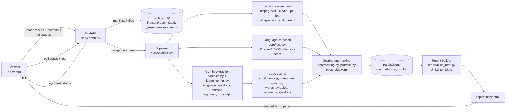

# DubQA v2 architecture

Source for the diagram: `docs/architecture.mmd` (Mermaid).

## Data flow

1. The browser (`server/static/index.html`) builds a manifest and uploads the videos to `POST /api/runs`.
2. The server validates the upload, creates `runs/<run_id>/`, writes `run.log`, and starts a background thread.
3. The pipeline (`core/pipeline.py`) runs once per video:
   - **Local measurement:** audio extraction, energy VAD, lip tracking (MediaPipe, or precomputed JSON), word timing (Whisper, or precomputed JSON), lexical alignment, drift and sync metrics.
   - **Language:** Whisper's detected language, or the words file's `language` field, then Gemini's language, then the Unicode script of the transcript. A declared language in the manifest wins; disagreement is recorded as a note.
   - **Gemini extraction (`core/info.py`):** one call per video returns language, speakers, and segments with approximate times, speaker, emotion, tone, and transcript. Results are cached in `runs/<run_id>/gemini/`.
   - **Code counts:** word counts and syllable counts (heuristic) per segment and in total, segment and speaker counts, emotion agreement for matched segments. Source and dub segments are paired by time overlap.
   - **Scoring:** thresholds from `config/thresholds.yaml`, Good/Check/Fix labels, weighted composite, coverage, release gate, competition ranking, pairwise comparison.
4. The results go to `results.json` and `run_meta.json`. The report builder renders `report/index.html` from them.
5. The browser polls `GET /api/runs/{id}` for status and `GET /api/runs/{id}/log?offset=N` for log lines, then embeds the report when the run is done.

## Module map

| Module | Responsibility |
|---|---|
| `server/app.py` | HTTP API, background jobs, per-run log file |
| `server/static/index.html` | Upload form, platform choice, live log, results and report view |
| `core/pipeline.py` | Orchestrates one run |
| `core/lang.py` | Language detection and resolution (declared vs detected) |
| `core/info.py` | Gemini extraction, validation, segment matching, summary, required-data checklist |
| `core/judge_gemini.py` | Shared Gemini upload-and-generate call; per-segment judge prompt |
| `core/counts.py` | Word tokenizer, word and syllable counts (Latin and Devanagari) |
| `core/asr.py` | Whisper word timestamps and detected language |
| `core/lips.py`, `core/vad.py`, `core/timing.py` | Lip opening, speech intervals, drift and sync metrics |
| `core/align.py` | Word alignment, lexical fidelity, missing sentences |
| `core/scoring.py`, `core/pairwise.py` | Labels, composite, ranking, head-to-head comparisons |
| `report/build_html.py`, `report/templates/report.html` | Report generation |

## What Gemini does and does not do

- **Does:** identifies language, speakers, emotion, tone, and transcript for each segment.
- **Does not:** produce timing, lip-sync, or any measured number. Its segment times are approximate and used only to pair segments and label the report.
- **Code does:** every count and difference in the report is computed from the Gemini transcripts or the measured words.

## Known limits

- Syllable counts are heuristic. Devanagari is handled by vowel-nucleus rules; other Latin-script languages are approximate.
- Languages written in Latin script cannot be separated by script alone. Set the language in the form, or rely on Whisper or Gemini.
- Whitespace-based word counting does not split CJK text.
